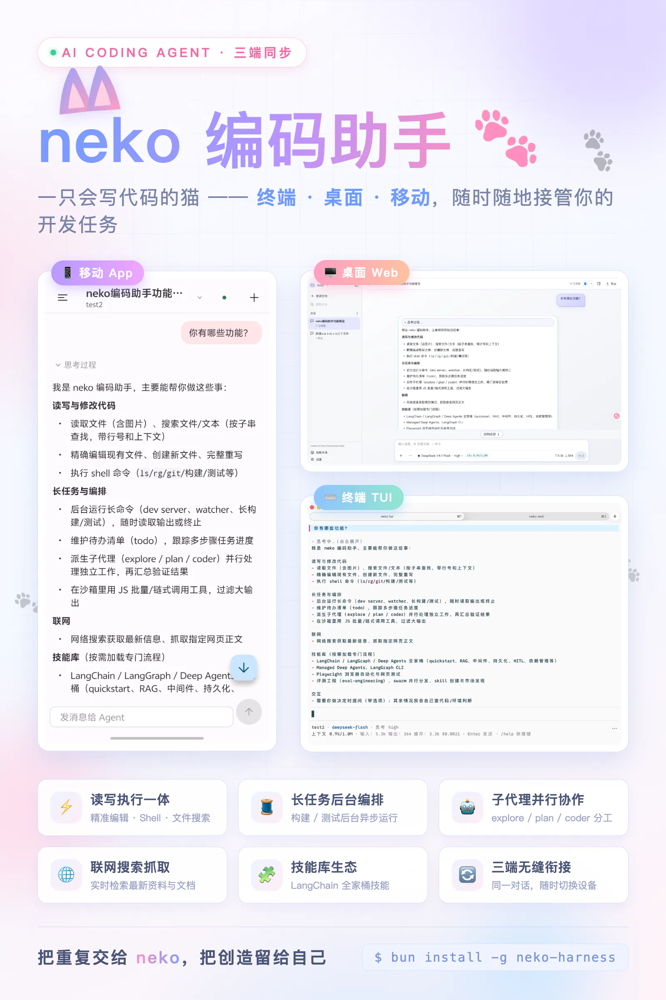

# neko-harness

[English](../README.md) | **简体中文**

在终端、浏览器和手机中使用的本地 AI 编程助手：读写项目文件、执行命令、接受图片、联网搜索、调用技能、委派子 agent。会话自动保存。

> 本页是母版。若与英文版 [README.md](../README.md) 不一致，以本页为准。

<p align="center">
	
</p>

## 目录

- [环境要求](#环境要求)
- [快速开始](#快速开始)
- [首次使用](#首次使用)
- [功能](#功能)
- [规划模式](#规划模式)
- [配置](#配置)
- [安全](#安全)
- [升级](#升级)
- [开发](#开发)
- [更多文档](#更多文档)
- [许可证](#许可证)

## 环境要求

- **Bun 1.4.x**（推荐 1.4.4），见 [Bun 安装说明](https://bun.sh/docs/installation)。找不到 `neko` 命令时，将 Bun 的 bin 目录加入 `PATH`（`~/.bun/bin`，Windows 为 `%USERPROFILE%\.bun\bin`）。
- macOS、Linux 或 Windows。**Windows 还需要 [Git for Windows](https://git-scm.com/download/win)**：bash 工具、后台任务与子 agent 经 Git Bash 运行，neko 会自动查找（可用 `shell.path` 覆盖）。
- 一个模型 API Key。默认 DeepSeek 开箱可用，另有 31 个纯 API Key 服务可启用。

## 快速开始

```bash
bun add --global neko-harness

cd /path/to/your/project
neko tui   # 终端界面
neko web   # 浏览器界面
```

`neko` 启动所请求的界面，并在没有网关时拉起一个网关——会话、工具与手机入口都由它持有。

| 命令 | 启动内容 |
| --- | --- |
| `neko tui` | 终端界面，按需拉起网关。POSIX 上 TUI 经 Unix socket 连接网关，Windows 走本机 WebSocket。 |
| `neko web` | Web 界面（`http://127.0.0.1:8322`）与网关 WebSocket（`127.0.0.1:8321`）；已有网关时直接复用，默认自动打开浏览器（`--no-open` 关闭）。 |
| `neko serve` | 仅网关：WebSocket `127.0.0.1:8321`，POSIX 另有 Unix socket。不启动界面也能让会话、后台任务与手机入口保持可用。 |

两种界面可同时使用，共享一个网关。拉起网关的进程退出时会一并关停它，需要网关长期运行时改用 `neko serve`——例如关闭网页后仍希望手机保持连接。

## 首次使用

TUI 输入 `/login`，或打开 Web「设置 → 模型服务」，填入 [DeepSeek API Key](https://platform.deepseek.com/api_keys) 并保存。默认模型为 `deepseek/deepseek-flash`（DeepSeek V4.1 Flash）；在模型选择器中切换模型，TUI 用 `/think` 调整思考强度。

也可用环境变量提供 Key（`DEEPSEEK_API_KEY`、`OPENROUTER_API_KEY`、`OPENCODE_API_KEY`、`TAVILY_API_KEY` 等）。界面保存的 Key 优先于环境变量，且仅保存在本机。

**其他模型服务。** 除 DeepSeek 外有 31 个纯 API Key 服务（OpenRouter、OpenCode Go / Zen、OpenAI、Google、Groq、Mistral、xAI、Together 等）。在 `/login`（空格勾选）或「设置 → 模型服务」中启用，再保存其 Key 或提供对应环境变量——Web 配置页的服务卡片会显示准确的变量名。启用后模型出现在 `/model` 与输入框的模型选择器里。取消启用不会删除已保存的 Key，但使用该服务的会话将无法发送新消息，直到重新启用或把会话切到其他模型。`--model` 的格式为 `provider/modelId`，例如 `openrouter/anthropic/claude-haiku-4.5`。

**默认模型。** 在模型选择器里把某个模型「设为默认」：Web 用行内操作，TUI 在 `/model` 列表按 `d`（再按一次取消）。优先级：`--model` > 保存的默认模型 > 配置文件 `defaultModel` > 内置 DeepSeek Flash。只影响之后新建的会话。

## 功能

### 工作区与文件

- 工作区是启动目录（`--cwd` 可指定）。助手不受工作区限制，它不是访问沙箱。
- Web 侧栏可添加、切换、移除项目，浏览文件树，查看本次会话产生的改动（含 diff），并在本机用 VS Code 或文件管理器打开文件夹——后两项仅在运行 Web 服务的机器上可用。
- 移除项目只是把它和它的会话从列表里隐藏：不删除任何文件，重新添加同一目录即可恢复。Web 服务的启动目录、最后一个项目，以及有运行中会话（或正等待回答、计划决定）的项目不能移除。
- 输入 `@` 引用文件或目录。图片：TUI 用 `Ctrl+V`（Windows 与 WSL 为 `Alt+V`，那里粘贴由终端处理）；Web 支持粘贴、拖放与选择。识图能力取决于所选模型。
- 会话：TUI 用 `/new`、`/sessions`，Web 用侧栏；TUI 另有 `/fork` 与 `/archive`，Web 侧栏可归档。

### 对话与排队

- 助手运行中发送的消息会进入排队，而不是打断当前工作。排队条（Web 在输入区上方，TUI 用 `Alt+↑`）列出等待项，每项可**引导**（当前工具轮结束后加入进行中的工作）或**撤回**回到输入框。
- TUI 排队按键：`Alt+↑` 选中，`↑`/`↓` 移动，`Enter` 引导选中项，`Esc` 只撤回选中项、不停止运行。
- 运行中按 `Esc` 停止当前任务。

### 上下文与导出

- `/compact` 整理较长对话，可附加要求。自动压缩沿用 pi-durable 的原生策略：接近模型窗口上限才触发；可在 TUI `/context`、Web「设置 → 上下文」或配置文件 `context.compaction` 调整触发百分比、保留量与开关。界面保存的值优先于配置文件。
- 工具结果裁剪默认关闭。启用 `context.pruning` 后，上下文占用超过阈值时较旧的工具结果在模型上下文中替换为占位；界面、投影与导出仍是原始结果，模型需要时会重新执行工具。阈值与保留量在 `/context` 与设置页修改。
- 复制与导出：Web 在消息下方复制回答（不含思考过程），顶栏「导出」可选 Markdown、HTML、JSON 及是否包含思考过程。TUI 用 `/copy` 与 `/export [path] [--thinking]`；省略路径时写入工作区，且不覆盖已有文件。

### 扩展能力

- **技能。** 输入 `/skill:` 补全已安装技能；在 Web 侧栏「技能市场」或 TUI `/skills` 浏览与安装。提示词只带技能列表，正文在被调用时才读取。
- **子 agent。** 助手会把探索、规划或编码工作委派出去，等待结果后整合。Web 用委派卡片与侧栏，TUI 用 `/agents`；可只停止当前轮、保留该 agent 的上下文。探索子 agent 的 Bash 命令需逐次批准。
- **后台任务。** `job` 工具把长命令（`npm run dev`、`uv run` 等）转入后台，同时最多 4 个。任务结束时助手收到回报并继续处理；实时输出与手动停止在 Web 顶栏「任务」、TUI `/jobs`。网关重启时仍在运行的任务标记为已丢失，不会自动重跑。
- **待办。** 多步骤任务中助手维护一份有序、只读的待办：Web 顶栏「待办 n/m」、TUI `/todos`、手机聊天页进度入口查看。随会话保存，重启与压缩后仍在，子 agent 不能使用。
- **向你提问。** 缺少必要决策时，助手用 `ask_user` 提问：可单选或多选（带「推荐」提示但不预选），可附加文字，也可跳过。Web 在输入区上方、TUI 按 `Ctrl+O` 或 `/question`、手机在聊天页回答；选择需提交（TUI 按 `Enter`）才生效，等待期间助手暂停、期间发送的消息排到回答之后。问题与选项按纯文本显示。
- **Codemode。** 不必每步一次工具调用：助手可以写一小段 JavaScript 脚本，一次调用 `read`、`grep`、`edit`、`bash` 等工具。三种模式：`off`（默认）、`on`（普通工具之外再提供脚本工具）、`only`（模型只看到脚本工具以及待办、提问、子 agent）。在 TUI `/codemode`、Web「设置 → Codemode」或配置文件 `codemode.mode` 选择；界面保存的值优先于配置文件，只对新会话生效。嵌套调用在工具卡片里列出，脚本里的编辑与其他编辑一样出现在工作区「本次改动」。脚本在 worker 中运行（同时最多 2 个、每个 256 MiB），等待上限 60 秒；审批与 plan 模式对嵌套调用照常生效。
- **联网搜索。** 默认 Tavily（无 Key 时为有限流的 keyless 模式），也可改用 DeepSeek 搜索与抓取并复用 DeepSeek Key。在 Web「设置 → 联网搜索」、TUI `/search` 或配置文件 `webSearch.provider` 选择。DeepSeek 搜索按成功请求计费（5 元 / 千次）。

### 多端

**Web**：聊天、工作区侧栏（文件、改动、在本机打开）、技能市场，以及设置页：`/settings` 模型服务、`/settings/search` 联网搜索、`/settings/context` 上下文、`/settings/codemode` Codemode、`/settings/appearance` 外观、`/settings/language` 语言、`/settings/mobile` 手机配对、`/about` 关于与更新。工作区、任务、子 agent 三个右侧面板共用同一个宽度：拖拽边缘（或用 ←/→、Home/End，双击恢复默认）调整，宽度记在浏览器里。

Web 界面有中文（默认）与 English 两种语言，在「设置 → 语言」切换；「设置 → 外观」可选主题（樱花、纸白、夜墨）和聊天排版（字体、字号、字重、行高）。两者只保存在当前浏览器，不影响 TUI 与手机端。

**TUI**：`/` 补全命令、`@` 补全文件、`/skill:` 补全技能；`/help` 列出全部快捷键与命令。

| 命令 | 用途 |
| --- | --- |
| `/login`、`/model`、`/think` | 模型服务与 Key、模型、思考强度 |
| `/new`、`/sessions`、`/fork`、`/archive` | 会话 |
| `/compact`、`/context` | 压缩、裁剪及其设置 |
| `/codemode` | 新会话的 codemode 模式（off、on、only） |
| `/copy`、`/export` | 复制上一条回答、导出会话 |
| `/agents`、`/jobs`、`/todos`、`/question`、`/plan` | 委派、后台任务、待办、提问、规划模式 |
| `/search`、`/skills`、`/theme`、`/language`、`/version`、`/help` | 搜索服务、技能市场、主题、界面语言、版本与更新、快捷键 |

终端主题可用 `--theme light|dark|auto`（默认 `auto`）、环境变量 `NEKO_THEME` 或 `/theme` 切换。

界面语言（默认 `zh`，可选 `en`）可用 `--lang zh|en`、环境变量 `NEKO_LANG` 或 `/language` 切换，选择会被保存。Web 与移动端各自有独立的语言设置。

**手机（测试版）**：Android 应用（[Flutter](../apps/mobile/README.md)），通过局域网控制电脑上的助手。Web「设置 → 手机配对」展示二维码，用应用扫码连接；手机需与电脑同一网络，系统防火墙放行所选端口（WSL 默认 NAT 会自动经 `powershell.exe` 转发）。应用只信任配对时取得的证书指纹，撤销设备、重新生成证书都在同一页完成。APK 附在 [GitHub Releases](https://github.com/kirineko/neko-harness/releases)（`NekoAI-v<版本>-<abi>.apk`，arm64-v8a / armeabi-v7a / x86_64）。测试版使用 debug 签名：升级需卸载重装并重新扫码配对，也没有应用内升级。

## 规划模式

只读调研加一步显式批准。

- **进入与退出。** TUI 用 `/plan` 或 `Shift+Tab`（仅空闲会话）；Web 在输入框输入 `/plan`。模式开启时输入区显示「规划模式（只读）」标识。
- **助手能做什么。** 读文件、搜索代码、联网、维护待办、提问，以及只读 bash（列目录、搜索、`git log`/`diff`/`status`、版本查询）。`edit`、`write`、`job` 与任何改文件、装依赖或启动进程的命令都会被拒绝：工具从 agent 配置中移除，`beforeTool` 再拦一层，bash 执行时第三次复核（是护栏，不是沙箱）。允许探索与规划子 agent，不允许编码子 agent。
- **提交计划。** 理解任务后，助手单独调用一次 `submit_plan`（标题、有序步骤、可选说明：风险、假设、验证方式），本轮随即结束，会话空闲等待决定。
- **做决定。** Web 的计划卡片在输入区上方，TUI 的计划面板会自动打开。「批准并执行」退出规划模式，并把计划作为下一条输入提交，立即开始执行；「要求修改」填写意见、保持规划模式，助手修订后重新提交；「取消并退出计划模式」把待批准计划置为已取消（Web 按钮、TUI `X`）。TUI 按键：`↑`/`↓` 选择、`A` 批准、`R` 写修改意见、`X` 取消并退出、`Esc` 只关面板不做决定。
- **边界情况。** 计划待批准时发送普通消息会取代该计划；停止会话或退出规划模式会取消它，重启则保留。模式与最近 5 条计划随会话保存，分叉会话一并继承。
- **手机。** 已配对手机可查看计划并批准、要求修改或取消并退出，但不能进入规划模式。模式切换与决定只在会话空闲时受理。

## 配置

### 命令行

优先级：命令行 > 配置文件 > 内置默认。`neko tui --help`、`neko web --help`、`neko serve --help` 列出全部选项。

| 选项 | 适用 | 说明 |
| --- | --- | --- |
| `--cwd <dir>` | tui、web、serve | 会话工具的工作目录（默认启动目录）。不是访问沙箱 |
| `--model <ref>` | tui、web、serve | `provider/modelId`，覆盖本次启动的默认模型 |
| `--storage <path>` | tui、web、serve | SQLite 文件（默认 `~/.neko/neko.sqlite`） |
| `--port <n>` | web、serve | Web 界面端口（默认 8322）或网关 WebSocket 端口（默认 8321，Windows 随机） |
| `--gateway-port <n>` | web | Web 拉起网关时使用的 WebSocket 端口 |
| `--host <ip>` | web、serve | Web 服务地址，或网关 WebSocket 地址（默认 `127.0.0.1`） |
| `--no-open` | web | 启动后不自动打开浏览器 |
| `--socket-path <path>` | tui、web、serve | Unix socket 路径（仅 POSIX） |
| `--no-socket` | serve | 禁用 Unix socket 传输 |
| `--theme <mode>` | tui | `light`、`dark`、`auto`（默认） |
| `--lang <lang>` | tui | `zh`（默认）或 `en`；优先于 `NEKO_LANG` 与已保存的选择 |
| `--credentials <path>` | serve | 凭据文件（默认 `~/.neko/credentials.json`） |
| `--config <dir>` | serve | 配置文件查找起点 |

### 配置文件

`neko.config.json` 从工作目录向上查找到根目录；都没有则使用 `~/.neko/neko.config.json`。文件是一个 JSON 对象；字符串里的 `$NAME` 与 `${NAME}` 会从环境变量替换，引用未设置的变量视为错误。

```json
{
	"defaultModel": { "provider": "deepseek", "modelId": "deepseek-flash" },
	"thinkingLevel": "high",
	"webSearch": { "provider": "tavily" },
	"codemode": { "mode": "off" },
	"context": {
		"compaction": { "enabled": true, "triggerPercent": 80, "keepRecentTokens": 20000 },
		"pruning": { "enabled": false, "triggerPercent": 35, "keepRecent": 10 }
	}
}
```

| 键 | 说明 |
| --- | --- |
| `defaultModel` | 新会话的 `{ provider, modelId }`，优先级低于 `--model` 与界面保存的默认模型 |
| `thinkingLevel` | 新会话的思考强度（默认 `high`，会按模型支持的范围调整） |
| `storagePath` | SQLite 文件，等同 `--storage` |
| `gateway.host`、`gateway.port`、`gateway.socketPath` | 网关监听地址、WebSocket 端口与 Unix socket 路径（`socketPath: null` 表示禁用 Unix 传输） |
| `skills.marketUrl` | 技能市场地址（默认 `https://skill.kirineko.tech`） |
| `webSearch.provider` | 初始搜索服务：`tavily` 或 `deepseek`；界面保存的选择优先 |
| `context.compaction` | `enabled`、`triggerPercent`（1–99）、`keepRecentTokens`；未设置的字段保持原生策略 |
| `context.pruning` | `enabled`、`triggerPercent`（1–99）、`keepRecent`、`minChars`、`minSavePercent`；默认关闭 |
| `codemode.mode` | `off`（默认）、`on` 或 `only`；只对新会话生效，界面保存的选择优先 |
| `shell.path` | Windows 上的 Git Bash `bash.exe`（会拒绝 WSL 的 `bash.exe`） |

### 数据与环境变量

- `~/.neko/neko.sqlite`：会话、消息、文档与设置，包括各界面保存的值（默认模型、已启用的服务、上下文设置、codemode 模式、搜索服务）。
- `~/.neko/credentials.json`：界面保存的 Key，以纯文本形式存给当前用户。要重置某个服务的 Key，从界面或该文件删除即可。
- `~/.neko/gateway-server-id` 与 socket / 端口文件：界面用于发现网关，可自动重建；`~/.neko/update-check.json` 缓存上次更新检查。
- 环境变量：每个服务一个（`DEEPSEEK_API_KEY`、`OPENROUTER_API_KEY`、`OPENCODE_API_KEY` 等）、`TAVILY_API_KEY` 用于联网搜索、`NEKO_THEME` 控制 TUI 主题、`NEKO_LANG` 控制 TUI 语言。

## 安全

助手会执行命令和修改文件：请在可信项目中使用，并记住工作区不限制它的文件访问范围。Web 界面与网关默认只监听回环地址；手机配对、在本机打开工作区与手机 API 只接受本机访问，远程请求一律拒绝。Key 只会发往对应的服务。导出与备份可能包含代码、提示词与 Key——复制 `~/.neko/` 前先退出所有 neko 进程，并把副本视为敏感数据。

## 升级

先完成任务，退出所有 neko 界面与服务，执行 `neko update`，完成后重新启动。Windows 上 `neko update` 会显示手动升级指引：先退出 neko，再运行 `bun add --global neko-harness@latest`。

0.5.0 把应用协议升到 9（项目移除）。旧版本的界面或网关会被新版本以协议提示拒绝，所以升级后请重启所有 neko 进程。

TUI 输入 `/version`，或打开 Web「设置 → 关于与更新」，可查看版本、检查更新并按提示重启或刷新。若当前版本没有 `neko update` 命令，可重新运行 `bun add --global neko-harness`。

## 开发

源码开发使用 Bun 1.4.4（见 `.bun-version`，任意 1.4.x 可用）；Windows 还需要 Git for Windows。

```bash
bun install --frozen-lockfile
bun run neko tui        # 从源码启动 TUI（自动拉起网关）
bun run neko web        # 从源码启动 Web UI
bun run neko serve      # 仅启动网关
```

| 命令 | 说明 |
| --- | --- |
| `bun run build` | tsc 构建全部 workspace 包（web 另含 vite build） |
| `bun run test` | Bun test（`--conditions=neko-source --parallel`）：完整套件在笔记本上约 12 秒 |
| `bun run test:serial` | 同样的测试逐个顺序执行（`--isolate`），用来区分真实失败与时序问题 |
| `bun run check` | biome check + 根/Web 客户端类型检查 |
| `bun run check:write` | biome 修复 + 根/Web 客户端类型检查 |
| `bun run build:release` | 以发布标记构建 `dist/` 可执行包 |
| `bun run test:package` | 打包到 `artifacts/`，在临时目录安装并冒烟验证 |

目录结构：

- `packages/core`：会话运行时、系统提示词、工具与 provider 目录
- `packages/gateway`：Chord / WebSocket 网关与手机 API
- `packages/tui`、`packages/web`、`packages/cli`：两个前端与 `neko` 命令入口
- `apps/mobile`：Flutter 手机端（测试版）
- `openspec/` 变更与规格、`docs/` 协议文档、`scripts/` 构建与发布脚本

约定：Biome（tab 缩进、双引号、120 列）；相对导入带 `.ts` 扩展名；TypeScript strict + `noUncheckedIndexedAccess` + `erasableSyntaxOnly` + `verbatimModuleSyntax`。`reference/` 只读；`dist/`、`artifacts/` 不提交；行为改动走 `openspec/` 变更。提交前运行 `bun run check` 与 `bun run test`。发版通过推送 `vX.Y.Z` tag 触发（见 [docs/dev/releasing.md](dev/releasing.md)），普通 push 不跑 CI。

## 更多文档

- [docs/README.md](README.md)：文档索引
- [AGENTS.md](../AGENTS.md)：架构、模块与开发约定
- [README.md](../README.md)：英文版文档
- [docs/mobile/api-v1.md](mobile/api-v1.md)：手机端 JSON-RPC 协议
- [apps/mobile/README.md](../apps/mobile/README.md)：Flutter 测试版的开发与发版
- [docs/dev/releasing.md](dev/releasing.md)：发布流程
- [openspec/](../openspec)：变更提案与规格

## 许可证

[MIT](../LICENSE)。基于 [Pi](https://github.com/earendil-works/pi) 生态构建。
